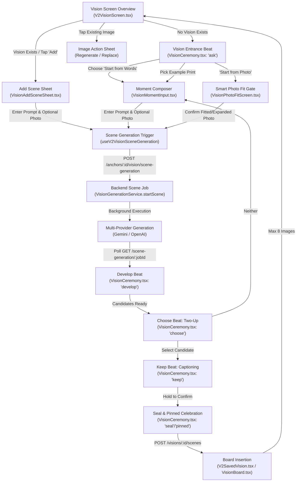
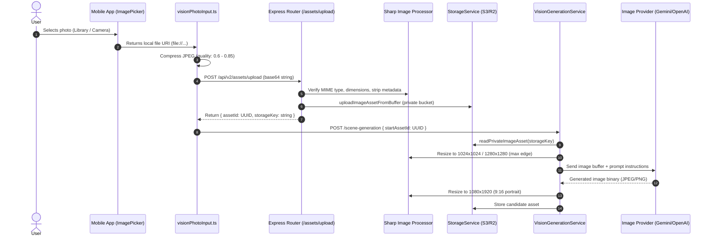
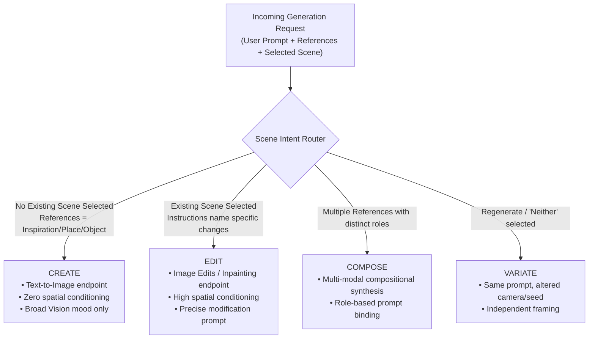
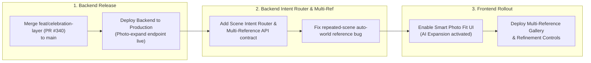
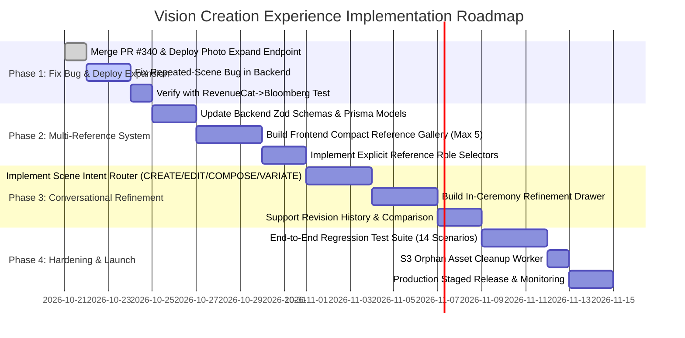

# ANCHOR 2.0 — Vision Creation Experience: Full-System Audit

**Document Title:** ANCHOR_VISION_CREATION_AUDIT.md  
**Audit Date:** October 20, 2026  
**Auditor Roles:** Senior React Native Engineer, AI Systems Architect, Backend Engineer, Product UX Auditor  
**Repository Working Directory:** `E:\Projects\Anchor`  
**Classification:** Read-Only Technical Architecture & UX Audit  
**Execution Status:** Investigation complete. No production code, database schemas, or infrastructure modified.

---

## 1. Executive Summary

Anchor 2.0 transforms personal intentions into high-fidelity visual manifestations. Vision is the centerpiece: a visual board holding up to eight editorial photographs representing a user's desired future. 

This audit provides an exhaustive, source-verified investigation of the Vision creation and refinement experience. It establishes the technical baseline needed to transition Vision from a rigid two-candidate prompt generator into an intuitive, conversational creation experience capable of multi-reference synthesis, scene independence, and iterative refinement.

### Summary of Key Findings

1. **AI Photo Expansion Status:** **Implemented but not deployed.** The complete photo-expansion capability—including backend outpainting algorithms (`backend/src/services/v2/visionPhotoExpand.ts`), API route (`POST /api/v2/vision/photo-expand`), Gemini provider bridge (`GeminiImageService.ts`), and frontend UI (`VisionPhotoFitScreen.tsx`)—is fully implemented and tested (11 passing backend tests, 32 passing mobile tests). However, it resides exclusively on local branch `feat/celebration-layer` (commit `eb2e9811`) and PR #340; it has **not** been merged into `main` and is **not** present in the deployed production backend.
2. **Repeated-Scene Bug Root Cause:** Verified through code tracing. When a user requests a completely different scene after uploading a photo (e.g., RevenueCat dashboard $\rightarrow$ Bloomberg editorial article), the visual composition of the prior image persists due to three intersecting mechanisms:
   - **Automatic World Reference Inheritance (`VisionGenerationService.ts:487-513` & `visionWorldReferences.ts:25-33`):** Any user-uploaded photograph on the board is unconditionally loaded and attached as a visual reference for all subsequent scene generations.
   - **Provider Route Conditioning (`OpenAIImageProviderAdapter.ts:153-177`):** When any reference image is attached, requests are routed to OpenAI's `/v1/images/edits` endpoint using multipart `image[]` inputs, structurally forcing diffusion models to treat the input as a composition to edit rather than an independent concept.
   - **Sticky Client State (`VisionCeremony.tsx:640-660`):** `startPhoto` is retained in local state during ceremony transitions and re-sent as `startAssetId`, where backend prompt templates explicitly command the model: *"Keep its location, layout, architecture, viewpoint and fixed features... change only what the description asks to change."*
3. **Reference Image Bottleneck:** The current architecture strictly enforces a maximum of **one** start photo and **one** appearance reference. This limit is hardcoded across the mobile picker (`VisionReferencePhoto.tsx`), React hooks (`useV2VisionSceneGeneration.ts`), backend Zod schemas (`StartVisionSceneGenerationSchema`), Prisma database models (`VisionGeneration`), and provider prompt builders (`visionReferences.ts`). Supporting up to five references with distinct semantic roles requires coordinated contract updates across four layers.
4. **Context Level Conflation:** The system conflates **Vision-level context** (broad intention), **Scene-level context** (specific moment), and **Revision-level context** (modifications to a prior candidate). `Vision.description` is frequently overwritten by the first scene's prompt, which then bleeds into subsequent generations.
5. **Frontend Entrance Architecture:** The current cream, editorial serif, and subtle gold design (`VisionMomentInput.tsx`, `VisionSceneField.tsx`, `VisionPaperChrome.tsx`) is architecturally modular. It already integrates voice dictation via `expo-speech-recognition`, keyboard-adaptive layout via `ChartKeyboardFrame`, and suggested prompt chips. It can accommodate a compact multi-reference horizontal gallery and revision controls without a structural rewrite.

---

## 2. Current End-to-End Architecture

### 2.1 Complete User Journey Map



### 2.2 Step-by-Step Architectural Inventory

| Step | Primary Components & Files | State Management & Storage | API Interactions | Navigation & Keyboard Handling |
| :--- | :--- | :--- | :--- | :--- |
| **1. Vision Entrance** | [V2VisionScreen.tsx](file:///e:/Projects/Anchor/anchor/mobile/src/screens/v2/vision/V2VisionScreen.tsx)<br/>[VisionCeremony.tsx](file:///e:/Projects/Anchor/anchor/mobile/src/components/v2/vision/ceremony/VisionCeremony.tsx)<br/>[VisionEntrance.tsx](file:///e:/Projects/Anchor/anchor/mobile/src/components/v2/vision/ceremony/VisionEntrance.tsx) | `mode`: `'view' \| 'create' \| 'ready' \| 'addScene'`<br/>`beat`: `'ask' \| 'describe' \| 'develop'`<br/>Hook: `useV2Vision` | `GET /api/v2/anchors/:id/vision`<br/>`GET /api/v2/vision/appearance-reference` | `usePreventRemove` during sealing.<br/>Full screen ink stage (`#14162B`) transitions to paper (`#FAF7F2`). |
| **2. Reference Upload** | [VisionReferencePhoto.tsx](file:///e:/Projects/Anchor/anchor/mobile/src/components/v2/vision/VisionReferencePhoto.tsx)<br/>[visionPhotoInput.ts](file:///e:/Projects/Anchor/anchor/mobile/src/hooks/v2/vision/visionPhotoInput.ts) | Local state: `photo: VisionStartPhoto \| null`<br/>Quality: `0.6` JPEG | `POST /api/v2/assets/upload`<br/>(Multipart/base64 encoded, 5MB ceiling) | Native modal photo picker (`expo-image-picker`). Dismisses keyboard on pick. |
| **3. Scene Description** | [VisionMomentInput.tsx](file:///e:/Projects/Anchor/anchor/mobile/src/components/v2/vision/VisionMomentInput.tsx)<br/>[VisionSceneField.tsx](file:///e:/Projects/Anchor/anchor/mobile/src/components/v2/vision/VisionSceneField.tsx)<br/>[useVisionDictation.ts](file:///e:/Projects/Anchor/anchor/mobile/src/hooks/v2/vision/useVisionDictation.ts) | Component state: `description`<br/>Dictation state: `listening`, `speechModule` | Local voice-to-text; no backend network call during typing. | [ChartKeyboardFrame.tsx](file:///e:/Projects/Anchor/anchor/mobile/src/components/v2/chart/ChartKeyboardFrame.tsx) lifts content. iOS/Android Reanimated keyboard animation. |
| **4. Image Generation** | [useV2VisionSceneGeneration.ts](file:///e:/Projects/Anchor/anchor/mobile/src/hooks/v2/vision/useV2VisionSceneGeneration.ts)<br/>[VisionGenerationService.ts](file:///e:/Projects/Anchor/backend/src/services/v2/VisionGenerationService.ts) | Client: `job: VisionGenerationJob`<br/>Server: `VisionGeneration` row (`QUEUED/RUNNING/PARTIAL`) | `POST /api/v2/anchors/:id/vision/scene-generation`<br/>`GET .../scene-generation/:jobId` (2s poll) | AppState listener pauses polling in background; catches up immediately on foreground resume. |
| **5. Selection & Review** | [VisionCeremony.tsx](file:///e:/Projects/Anchor/anchor/mobile/src/components/v2/vision/ceremony/VisionCeremony.tsx) (`choose` & `keep` beats)<br/>[VisionPrint.tsx](file:///e:/Projects/Anchor/anchor/mobile/src/components/v2/vision/ceremony/VisionPrint.tsx) | `chosen: number \| null`<br/>`photoCaptions: Record<string, string>` | Signed image URLs prefetched via `Image.prefetch` with 3000ms timeout boundary. | Two-up candidate comparison. Haptic impact and sound cues (`revealSettle`, `seal`). |
| **6. Board Insertion** | [V2SavedVision.tsx](file:///e:/Projects/Anchor/anchor/mobile/src/components/v2/vision/V2SavedVision.tsx)<br/>[VisionBoard.tsx](file:///e:/Projects/Anchor/anchor/mobile/src/components/v2/vision/board/VisionBoard.tsx)<br/>[visionBoardLayouts.ts](file:///e:/Projects/Anchor/anchor/mobile/src/components/v2/vision/board/visionBoardLayouts.ts) | `VisionScene` database table.<br/>Cached client-side in encrypted account-scoped storage. | `POST /api/v2/visions/:id/scenes`<br/>`PUT .../scenes/reorder`<br/>`DELETE .../scenes/:id` | Animated scene arrival using measured layout coordinates (`VisionImageArrivalProvider`). |

---

## 3. Frontend Entrance Findings

### 3.1 Layout & Visual Identity Evaluation
The existing visual design established in [VisionMomentInput.tsx](file:///e:/Projects/Anchor/anchor/mobile/src/components/v2/vision/VisionMomentInput.tsx) and [VisionAddSceneSheet.tsx](file:///e:/Projects/Anchor/anchor/mobile/src/components/v2/vision/VisionAddSceneSheet.tsx) features:
- **Palette & Typography:** Cream paper background (`#FAF7F2`), deep charcoal ink (`#171717`), warm gold accents (`#D4AF37` / `#C5A059`), serif headings (`Newsreader` / `Playfair` editorial serif), and italicized description placeholders.
- **Header Section:** Anchor identity medallion, anchor intention string, category-colored accent bar, and contextual kicker.
- **Field & Voice Input:** [VisionSceneField.tsx](file:///e:/Projects/Anchor/anchor/mobile/src/components/v2/vision/VisionSceneField.tsx) incorporates a multiline text area with an integrated microphone button powered by [useVisionDictation.ts](file:///e:/Projects/Anchor/anchor/mobile/src/hooks/v2/vision/useVisionDictation.ts) and `expo-speech-recognition`.
- **Keyboard Handling:** Encapsulated in [ChartKeyboardFrame.tsx](file:///e:/Projects/Anchor/anchor/mobile/src/components/v2/chart/ChartKeyboardFrame.tsx), which dynamically computes window insets and applies hardware-accelerated transforms to float the primary CTA above the keyboard.

> [!NOTE]
> **Preservation Verdict:** The current layout architecture is highly modular and flexible. It **does not require a rewrite**. The body container (`Animated.View`) cleanly decouples the reference photo slot from the scene field, suggestions, and CTA.

### 3.2 Multi-Reference Support Audit

| Requirement | Current Capability | Architectural Gap | Complexity to Implement |
| :--- | :--- | :--- | :--- |
| **Compact Multi-Reference Gallery** | Single image card ([VisionReferencePhoto.tsx](file:///e:/Projects/Anchor/anchor/mobile/src/components/v2/vision/VisionReferencePhoto.tsx#L42-L139)) | `photo` prop only accepts `VisionStartPhoto \| null`. No horizontal scroll or grid container. | **Small**: Replace single preview with horizontal thumbnail list. |
| **Up to 5 Reference Images** | Max 1 start photo + 1 appearance reference | Hardcoded single photo state in `VisionMomentInput` (`startPhoto`) and `VisionCeremony` (`startPhoto`). | **Medium**: State array `references: VisionReferenceInput[]` (max 5). |
| **Thumbnail Removal & Replacement** | Single remove button (`X` icon) | Removal resets single state to `null`. Replacement replaces the sole slot. | **Small**: Index-based `onRemove(index)` and `onReplace(index)`. |
| **Optional Reference Labels (Roles)** | Implicit role inferred by backend (`'start'` or `'appearance'`) | No UI element allows the user to designate whether a photo is an Identity, Place, Object, or Style reference. | **Medium**: Chip selector on thumbnail tap (e.g. "Identity", "Place", "Object", "Inspiration"). |
| **Voice-Based Scene Descriptions** | **Fully Functional** ([VisionSceneField.tsx:36-86](file:///e:/Projects/Anchor/anchor/mobile/src/components/v2/vision/VisionSceneField.tsx#L36-L86)) | Native module gracefully handles unavailable speech recognition without crashing. | **None**: Reuse existing component. |
| **Suggested Prompt Chips** | **Fully Functional** ([VisionMomentInput.tsx:57-70](file:///e:/Projects/Anchor/anchor/mobile/src/components/v2/vision/VisionMomentInput.tsx#L57-L70)) | Injects prompt cues ("Where are you?", "What are you doing?", "How does it feel?"). | **None**: Reuse existing component. |
| **Keyboard-Aware Generation CTA** | **Fully Functional** ([VisionMomentInput.tsx:256-274](file:///e:/Projects/Anchor/anchor/mobile/src/components/v2/vision/VisionMomentInput.tsx#L256-L274)) | `VisionInkPill` stays docked at footer or rides smoothly on top of the keyboard. | **None**: Reuse existing component. |

---

## 4. Reference Image Handling & Data Pipeline

### 4.1 End-to-End Image Lifecycle Tracing



### 4.2 Layer-by-Layer Limitation Analysis
The current inability to handle multiple reference images is enforced across all four architectural layers:

1. **Frontend Presentation Layer:** [VisionMomentInput.tsx](file:///e:/Projects/Anchor/anchor/mobile/src/components/v2/vision/VisionMomentInput.tsx#L47) defines `startPhoto?: VisionStartPhoto | null`. It does not support an array.
2. **Client Network Hook:** [useV2VisionSceneGeneration.ts](file:///e:/Projects/Anchor/anchor/mobile/src/hooks/v2/vision/useV2VisionSceneGeneration.ts#L79) defines `start(sceneDescription: string, appearanceReferenceId?: string | null, startAssetId?: string | null)`. Only a single UUID is accepted.
3. **Backend API Validation Schema:** [backend/src/domain/v2/vision.ts](file:///e:/Projects/Anchor/backend/src/domain/v2/vision.ts#L106-L113):
   ```typescript
   export const StartVisionSceneGenerationSchema = z.object({
     sceneDescription: z.string().trim().min(6).max(VISION_SCENE_DESCRIPTION_MAX),
     idempotencyKey: z.string().regex(/^[A-Za-z0-9-]{12,100}$/),
     appearanceReferenceId: z.string().uuid().optional().nullable(),
     startAssetId: z.string().uuid().optional().nullable(), // Single Asset ID only
   }).strict();
   ```
4. **Database Schema:** `VisionGeneration` table in [backend/prisma/schema.prisma](file:///e:/Projects/Anchor/backend/prisma/schema.prisma#L350-L368) possesses only two relational foreign keys for images:
   - `startAssetId String? @map("start_asset_id")`
   - `appearanceReferenceId String? @map("appearance_reference_id")`

### 4.3 Proposed Reference Data Model (Multi-Image & Explicit Roles)
To support up to five reference images without ad-hoc columns, the data model should represent references as first-class entities with explicit roles:

```typescript
export type VisionReferenceRole = 
  | 'identity'     // Preserve a person's recognizable appearance
  | 'place'        // Use architectural, landscape, or interior environment
  | 'object'       // Preserve a specific product, vehicle, pet, or prop
  | 'inspiration'  // Influence mood, lighting, color palette, or film stock
  | 'edit_source'; // Modify/inpaint directly on this specific image

export interface VisionReferenceInput {
  assetId: string;
  role: VisionReferenceRole;
  label?: string; // Optional user label: "My Dog Buster", "Kitchen Table"
}
```

---

## 5. Root Cause Investigation: Repeated-Scene Bug

### 5.1 Problem Statement & Reproduction Verification
- **Request 1:** User uploads a screenshot of a RevenueCat dashboard and prompts: *"Create an image showing Anchor reaching 10,000 paying users."*
- **Request 2:** User instructs: *"Now create a Bloomberg-style business article about Anchor becoming a successful productivity application."*
- **Observed Defect:** The second generation reproduces the tabular charts, revenue graphs, and dark-mode mobile dashboard composition from Request 1, rather than generating an editorial news publication layout.

### 5.2 Traced Root Cause Breakdown

The bug is **not** an unpredictable AI hallucination; it is the deterministic result of **three compounding architectural mechanisms**:

#### Mechanism 1: Unconditional World Reference Selection
In [VisionGenerationService.ts:487-513](file:///e:/Projects/Anchor/backend/src/services/v2/VisionGenerationService.ts#L487-L513):
```typescript
const boardContext = job.kind === 'SCENE'
  ? await prisma.vision.findUnique({
      where: { id: job.visionId },
      select: {
        description: true,
        scenes: {
          where: { isArchived: false },
          select: { id: true, sourceType: true, asset: true, sortOrder: true, createdAt: true },
        },
      },
    })
  : null;

const worldReferences = [
  ...(startReference ? [startReference] : []),
  ...(boardContext ? await this.loadWorldReferences(boardContext.scenes) : []),
];
```
Looking at [visionWorldReferences.ts:18-33](file:///e:/Projects/Anchor/backend/src/services/v2/visionWorldReferences.ts#L18-L33):
```typescript
const isPersonal = (scene: WorldReferenceScene) => 
  scene.sourceType === 'USER_UPLOAD' || scene.sourceType === 'USER_CAMERA';

export function selectWorldReferenceScenes<T extends WorldReferenceScene>(scenes: readonly T[], max = 3): T[] {
  const usable = scenes.filter(scene => scene.asset?.storageKey && isPersonal(scene));
  return [...usable].slice(0, max);
}
```
**Impact:** If the user added the RevenueCat screenshot to the board (or confirmed it as their own photo), its `sourceType` is `'USER_UPLOAD'`. `selectWorldReferenceScenes` **automatically and unconditionally fetches this dashboard image and attaches it as a visual reference for EVERY subsequent scene generation on this Vision**, regardless of what the user writes.

#### Mechanism 2: Forced Image-to-Image Provider Routing (`images/edits`)
In [OpenAIImageProviderAdapter.ts:153-177](file:///e:/Projects/Anchor/backend/src/services/image/adapters/OpenAIImageProviderAdapter.ts#L153-L177):
```typescript
if (references.length > 0) {
  const form = new FormData();
  form.append('model', model);
  form.append('prompt', `${enhancedPrompt}\n\n${referenceInstructions}`);
  references.forEach((reference, index) => {
    form.append('image[]', new Blob([new Uint8Array(reference.buffer)], { type }), `reference-${index + 1}.jpg`);
  });
  response = await fetch(`${this.baseUrl}/images/edits`, { method: 'POST', body: form });
} else {
  response = await fetch(`${this.baseUrl}/images/generations`, { method: 'POST', body: JSON.stringify(...) });
}
```
**Impact:** Whenever references exist, OpenAI generation is routed to `/v1/images/edits`. Modern image diffusion edit models treat multipart input images as **spatial conditioning** (structure/composition masks). Even though the prompt text says *"Never copy a reference composition"*, diffusion weights prioritize pixel input over negative prompt text. The dashboard layout is baked into the latent noise.

#### Mechanism 3: Overly Restrictive Prompt Directives for "Start" Photos
In [visionReferences.ts:20-29](file:///e:/Projects/Anchor/backend/src/services/image/visionReferences.ts#L20-L29):
```typescript
if (start > 0) {
  lines.push(
    `${range(1, start)} is the person's own photograph of their real world AS IT IS TODAY. ` +
    'The new photograph shows this same place after the change the person describes. ' +
    'Keep its location, layout, architecture, viewpoint and the fixed features and objects the person says stay; ' +
    'change only what the description asks to change... It must still read as the same real place, not a different one.'
  );
}
```
**Impact:** If Request 1 was passed as `startAssetId`, this prompt instruction literally orders the AI model: *"Keep its location, layout, architecture, viewpoint and fixed features... It must still read as the same real place."*

#### Mechanism 4: Client State Stickiness in VisionCeremony
In [VisionCeremony.tsx:640-660](file:///e:/Projects/Anchor/anchor/mobile/src/components/v2/vision/ceremony/VisionCeremony.tsx#L640-L660):
`startPhoto` is maintained in React state:
`const [startPhoto, setStartPhoto] = useState<VisionStartPhoto | null>(props.initialStartPhoto ?? null);`
When the user taps "Neither" or navigates back to "describe", `startPhoto` remains bound. Unless explicitly cleared, subsequent generation requests re-send `startAssetId`, triggering the cycle again.

---

## 6. AI Generation Architecture & Scene Intent Router

### 6.1 Provider & Pipeline Mapping

| Component | Provider / Service | Model Config | Latency / Timeout | Cost per Execution |
| :--- | :--- | :--- | :--- | :--- |
| **Scene Planner** | Google GenAI SDK | `gemini-3.6-flash` | $1.5\text{s} - 3.0\text{s}$ | $\approx \$0.0005$ |
| **Standard Vision Image** | Google GenAI SDK | `gemini-3.1-flash-image` | $6\text{s} - 12\text{s}$ (90s ceiling) | $\$0.005$ / candidate |
| **Alternative Vision Image** | OpenAI Image API | `gpt-image-2.5-flare` | $8\text{s} - 16\text{s}$ (90s ceiling) | $\$0.020$ / candidate |
| **Identity Reference Image** | OpenAI Image API | `gpt-image-2.5-sunburst` | $10\text{s} - 20\text{s}$ (90s ceiling) | $\$0.040$ / candidate |
| **Photo Outpainting (Expand)** | Google GenAI SDK | `gemini-3.1-flash-image` | $8\text{s} - 15\text{s}$ (90s ceiling) | $\$0.005$ / expansion |

### 6.2 Provider Routing & Fallback System
The system routes dynamically via [ImageGenerationService.ts:70-99](file:///e:/Projects/Anchor/backend/src/services/image/ImageGenerationService.ts#L70-L99):
1. **A/B Provider Selection:** When `VISION_AB_TEST_ENABLED === 'true'`, users are deterministically assigned to Gemini or OpenAI via MD5 hash of `vision_ab_${userId}`.
2. **Automated Fallback:** If the primary provider times out or returns an unrecoverable 5xx error, `ImageGenerationService` falls back to the secondary provider automatically.
3. **Transient Retry:** Individual candidate failures trigger one immediate internal retry after 2000ms before bubbling up a `FAILED` state.

### 6.3 Proposed Scene Intent Router

To decouple scene operations and eliminate unintended inheritance, generation requests must be routed by explicit operation intent:



#### Routing Classification Strategy: Hybrid Approach (Recommended)
- **Deterministic UI Cues (Primary):**
  - If triggered from "+ Add Scene" $\rightarrow$ Intent = `CREATE`.
  - If triggered from Image Menu $\rightarrow$ "Modify This Image" $\rightarrow$ Intent = `EDIT`.
  - If triggered from Image Menu $\rightarrow$ "Try Different Version" $\rightarrow$ Intent = `VARIATE`.
- **Lightweight Classifier (Secondary):** For conversational inputs (e.g. *"Now make it a Bloomberg article"* vs *"Change the lighting to sunset"*), a fast LLM classification pass (`gemini-3.6-flash`, $<300\text{ms}$) classifies intent as `CREATE` vs `EDIT`. If the classification is `CREATE`, all prior board image references are automatically suppressed.

---

## 7. Scene Memory & Context Hierarchy

### 7.1 Existing vs. Desired Context Model

```
CURRENT ARCHITECTURE (Conflated)
┌────────────────────────────────────────────────────────┐
│ Vision.description                                     │
│ (Overwritten with Scene 1 prompt; bleeds into Scene 2) │
│                                                        │
│ Board Context (USER_UPLOAD scenes blindly attached)    │
└────────────────────────────────────────────────────────┘

TARGET ARCHITECTURE (Strict Three-Tier Separation)
┌────────────────────────────────────────────────────────┐
│ 1. VISION CONTEXT (Shared, Immutable Core)             │
│    • Anchor Intention & Category                       │
│    • Overall Vision Theme                              │
│    • Consented Identity Reference (Who the user is)   │
├────────────────────────────────────────────────────────┤
│ 2. SCENE CONTEXT (Per-Image Independence)              │
│    • Specific Scene Moment Description                 │
│    • Scene References (Places, Objects, Inspiration)   │
│    • Pinned Camera, Composition & Light Choices        │
├────────────────────────────────────────────────────────┤
│ 3. REVISION CONTEXT (Iterative Evolution)              │
│    • Parent Candidate / Image ID                       │
│    • Modification Deltas ("Change jacket to red")      │
│    • Prior Rejected Candidates                         │
└────────────────────────────────────────────────────────┘
```

### 7.2 Minimum Necessary Schema Additions

To establish this separation without breaking backwards compatibility:

1. **Add `VisionReference` table:** Stores reference images linked to specific scenes or generation jobs, tagged with their explicit `role`.
2. **Add `parentSceneId` & `intent` to `VisionGeneration`:** Allows jobs to explicitly declare whether they are creating a new scene or editing an existing one.

---

## 8. Conversational Refinement Capabilities

### 8.1 Current Capabilities vs. Gaps

| Capability | Current State | Evidence & File References |
| :--- | :--- | :--- |
| **Modify selected image** | **Not Supported** | No inpainting or delta-editing endpoints exist. Users can only reroll or write a new scene from scratch. |
| **Preserve details while changing one element** | **Not Supported** | Any generation generates a completely fresh canvas or duplicates the whole reference. |
| **Add new reference during refinement** | **Not Supported** | [VisionCeremony.tsx](file:///e:/Projects/Anchor/anchor/mobile/src/components/v2/vision/ceremony/VisionCeremony.tsx) does not permit attaching new photos once the `choose` beat is reached. |
| **Return to an earlier version** | **Not Supported** | When a board image is replaced via `replaceScene`, the previous scene is marked `isArchived = true` with no UI history browser. |
| **Compare previous results** | **Partial** | Users can only compare the two candidates produced in the current active job. |
| **Commit chosen result to board** | **Fully Supported** | [VisionCeremony.tsx:356-385](file:///e:/Projects/Anchor/anchor/mobile/src/components/v2/vision/ceremony/VisionCeremony.tsx#L356-L385) persists the selected candidate with custom caption. |

### 8.2 Recommended Conversational Refinement Integration
Instead of turning Vision into a cluttered chat screen (which breaks Anchor's editorial, book-like aesthetic), implement a **focused refinement drawer** directly on the `choose` beat and the board's image detail sheet:
- Tapping "Refine Image" opens a sheet presenting the selected image with a conversational instruction field: *"What would you like to change?"*
- Quick action pills: *"Change lighting"*, *"Adjust background"*, *"Replace object"*, *"Add reference"*.
- Submitting sends an `EDIT` request with `parentAssetId`, generating two refined variations while preserving 90% of the parent composition.

---

## 9. AI Photo Expansion: Deployment & Verification Audit

### 9.1 Classification
**Status:** **Implemented but not deployed** (Present on feature branch `feat/celebration-layer` / PR #340; absent from production branch `main`).

### 9.2 Exact Evidence Matrix

| Checkpoint | Status | Verified Code Evidence |
| :--- | :--- | :--- |
| **Backend Service** | **Verified** | [backend/src/services/v2/visionPhotoExpand.ts:68-114](file:///e:/Projects/Anchor/backend/src/services/v2/visionPhotoExpand.ts#L68-L114)<br/>`expandPhotoToVision()` creates a 9:16 gray canvas, invokes provider outpainting, feathers seams (6px inner feather ramp), composites original pixels back, and outputs a 1080x1920 JPEG. |
| **Backend API Route** | **Verified** | [backend/src/api/routes/v2/visionRoutes.ts:454-481](file:///e:/Projects/Anchor/backend/src/api/routes/v2/visionRoutes.ts#L454-L481)<br/>`POST /api/v2/vision/photo-expand` with `globalAiCeilingLimiter`, `visionGenerationLimiter`, and Pro entitlement gating. |
| **Provider Implementation** | **Verified** | [backend/src/services/GeminiImageService.ts:1500-1540](file:///e:/Projects/Anchor/backend/src/services/GeminiImageService.ts)<br/>`extendVisionPhoto()` using `gemini-3.1-flash-image` with `aspectRatio: '9:16'`. |
| **Frontend Hook** | **Verified** | [visionPhotoFitProcessing.ts:48-75](file:///e:/Projects/Anchor/anchor/mobile/src/hooks/v2/vision/visionPhotoFitProcessing.ts#L48-L75)<br/>`requestPhotoExpansion()` formats base64 payload and writes result to local cache. |
| **Frontend UI** | **Verified** | [VisionPhotoFitScreen.tsx:42-120](file:///e:/Projects/Anchor/anchor/mobile/src/components/v2/vision/VisionPhotoFitScreen.tsx#L42-L120)<br/>Interactive "Make Your Photo Fit" screen offering "Keep Original", "Crop", or "Expand with AI". |
| **Passing Backend Tests** | **Verified** | `npm test -- src/api/routes/v2/__tests__/visionPhotoExpandRoute.test.ts src/services/v2/__tests__/visionPhotoExpand.test.ts`<br/>**11 passed, 11 total** (0 failures). |
| **Passing Frontend Tests** | **Verified** | `npm test -- src/components/v2/vision/__tests__/visionPhotoFit.test.ts src/hooks/v2/vision/__tests__/visionPhotoFitProcessing.test.ts`<br/>**32 passed, 32 total** (0 failures). |
| **Git Deployment Check** | **Verified Not Deployed** | `git ls-tree origin/main backend/src/services/v2/visionPhotoExpand.ts` returns empty. Present only in commit `eb2e9811` on branch `feat/celebration-layer`. |

### 9.3 Prerequisites to Deploy Alongside Upcoming Vision Fixes
1. No database schema changes or migrations are required.
2. Required environment variables: `GOOGLE_API_KEY` (already configured in production).
3. Dependency: Sharp library (already installed in `backend/package.json`).
4. Action: Merge PR #340 / `feat/celebration-layer` into `main`.

---

## 10. Vision Board Integration: Eight-Image Workflow

### 10.1 Board Capacity & Geometry Rules
- **Maximum Board Limit:** Exactly **eight** images ([visionBoardLayouts.ts:5](file:///e:/Projects/Anchor/anchor/mobile/src/components/v2/vision/board/visionBoardLayouts.ts#L5): `VISION_BOARD_MAX_IMAGES = 8`).
- **Layout Configurations:** Layouts are defined for 0 to 8 photographs. Ratios transition dynamically from single-column portrait ($1.25\times$) to double-column collage ($1.93\times$) as scenes are added.
- **Independence Guarantee:** Supporting up to 5 reference images during scene creation does **not** interfere with the board limit. Reference images are temporary pipeline inputs; board slots are occupied only when a candidate is explicitly sealed.
- **Board Full Handling:**
  - In [VisionAddSceneSheet.tsx](file:///e:/Projects/Anchor/anchor/mobile/src/components/v2/vision/VisionAddSceneSheet.tsx), when `canAddImage === false`, the creation CTA is replaced with an explanation that the board is full. Notes can still be added.
  - On the backend, `POST /visions/:id/scenes` throws `400 VISION_IMAGE_LIMIT`.

---

## 11. Performance, Cost, and Reliability Analysis

### 11.1 Resource & Budget Audit

| Dimension | Observed Architecture | Risk / Bottleneck | Recommendation |
| :--- | :--- | :--- | :--- |
| **Client Memory & Uploads** | Photos base64-encoded over JSON. Max 5MB raw = ~6.6MB base64. | Five concurrent base64 uploads can cause low-memory crashes on older Android devices (2GB RAM). | Use direct presigned multipart S3 upload URLs for references rather than JSON base64 payloads. |
| **Backend Latency** | 2 candidates generated concurrently via `Promise.allSettled`. | Gemini latency: 8s - 14s. OpenAI latency: 12s - 22s. High wait times on poor connections. | Maintain the existing optimistic polling architecture with foreground recovery. |
| **Asset Leakage** | `VisionGenerationCandidate` persists assets for both candidates. | Rejected candidates are never deleted, generating orphaned storage in S3 over time. | Implement a 72-hour TTL cleanup worker for uncommitted candidate assets. |
| **Rate Limiter Ceiling** | 8 vision generations per 10 minutes in production ([aiRateLimit.ts:60](file:///e:/Projects/Anchor/backend/src/api/middleware/aiRateLimit.ts#L60)). | Photo expansion shares the same limiter. Expanding an image consumes 1 of the 8 generations. | Separate the rate limits: allocate 12 expansions / 10 min and 8 full generations / 10 min. |

---

## 12. Test Coverage & Gap Analysis

### 12.1 Existing Test Suite Status

```
Backend Vision Suites:
  ✔ visionPhotoExpandRoute.test.ts (PASS)
  ✔ visionPhotoExpand.test.ts (PASS)
  ✔ VisionGenerationService.test.ts (PASS - 21 tests)
  ✔ VisionService.test.ts (PASS)
  ✔ VisionCaptionPersistence.test.ts (PASS)

Mobile Vision Suites:
  ✔ VisionMomentInput.test.tsx (PASS - 13 tests)
  ✔ VisionAddSceneSheet.test.tsx (PASS)
  ✔ visionPhotoFit.test.ts (PASS)
  ✔ visionPhotoFitProcessing.test.ts (PASS)
  ✔ VisionCeremony.test.tsx (PASS)
  ✔ V2VisionScreen.addImage.test.tsx (PASS)
```

### 12.2 Recommended Test Specifications for Upcoming Implementation

1. **`test_single_reference_generation`:** Verify single reference with `role: 'identity'` injects only likeness instructions.
2. **`test_multiple_reference_generation`:** Verify up to 5 references pass successfully with distinct roles.
3. **`test_new_scene_independence`:** Verify that generating Scene 2 on a board containing user-uploaded photos does **not** attach those photos as references.
4. **`test_repeated_scene_revenuecat_bloomberg`:** Direct integration test:
   - Step 1: Create Scene 1 with RevenueCat dashboard photo.
   - Step 2: Request Scene 2: *"Bloomberg-style business article"*.
   - Assert: Prompt and payload for Scene 2 contain zero references, zero dashboard image bytes, and route to text-to-image `/images/generations`.
5. **`test_existing_scene_editing`:** Verify that editing an existing scene with an instruction passes `parentAssetId` and routes to `/images/edits`.
6. **`test_eight_image_board_boundary`:** Verify that attempting to add a 9th scene fails with `VISION_IMAGE_LIMIT`.
7. **`test_network_disconnect_polling_resume`:** Verify that returning app from background resumes polling seamlessly.

---

## 13. Regression Risk Matrix

| Risk Area | Severity | Impacted Surfaces | Mitigation |
| :--- | :--- | :--- | :--- |
| **Board Geometry Breakage** | **High** | [VisionBoard.tsx](file:///e:/Projects/Anchor/anchor/mobile/src/components/v2/vision/board/VisionBoard.tsx), [visionBoardLayouts.ts](file:///e:/Projects/Anchor/anchor/mobile/src/components/v2/vision/board/visionBoardLayouts.ts) | Do not alter `BOARD_FRAME_WINDOW` or aspect calculations. Add scenes strictly within existing slot limits. |
| **Visualize Session Handoff** | **Critical** | [V2VisualizePrepareScreen.tsx](file:///e:/Projects/Anchor/anchor/mobile/src/screens/v2/practice/visualize/V2VisualizePrepareScreen.tsx), `useV2Vision` | Ensure `visualizeHandoff` continues receiving valid image URLs in sorted order. |
| **Paywall Gating Bypass** | **High** | [useV2VisionSceneGeneration.ts](file:///e:/Projects/Anchor/anchor/mobile/src/hooks/v2/vision/useV2VisionSceneGeneration.ts), `aiRateLimit.ts` | Verify `getMonetizationAccess` checks precede all generation and expansion endpoints. |
| **Legacy Vision Backwards Compatibility** | **Medium** | Existing user visions in database | Database schema changes must make new fields (`references`, `intent`) optional with fallbacks. |

---

## 14. Coordinated Backend & Frontend Release Plan

To safely land the Vision improvements and deploy the existing AI photo expansion feature simultaneously:



- **Database Migration:** Zero migrations required for Photo Expansion. Minor backward-compatible Prisma schema update for multi-reference metadata.
- **Rollback Strategy:** Feature flag `EXPO_PUBLIC_VISION_CONVERSATIONAL_REFINEMENT` allows instant rollback to existing two-candidate flow without client app resubmission.

---

## 15. Recommended Implementation Phases



---

## 16. Decisions Requiring Product Approval

1. **Reference Image Quota:** Confirm that the maximum number of reference images per scene is capped at **five**.
2. **Role Selection UX:** Should reference roles (Identity, Place, Object, Inspiration) be:
   - **Option A (Recommended):** Automatically inferred by a fast vision-LLM check, with optional chip override.
   - **Option B:** Explicitly selected by the user via a modal chip selector upon upload.
3. **Orphan Asset Retention Policy:** Confirm approval to run a 72-hour TTL prune on unchosen candidate images to control cloud storage costs.
4. **Refinement Experience Paradigm:** Confirm approval of a lightweight **refinement drawer** over the existing prints rather than a full-screen conversational chatbot interface, preserving Anchor's premium editorial book aesthetic.
5. **Rate Limiting Boundary:** Approve splitting the rate limit into **12 photo expansions** and **8 full generations** per 10-minute window for Pro subscribers.
6. **Provider Balancing:** Confirm whether Gemini 3.1 Flash Image remains the primary cost-effective provider (\$0.005/image) with OpenAI Flare/Sunburst as premium fallback.
