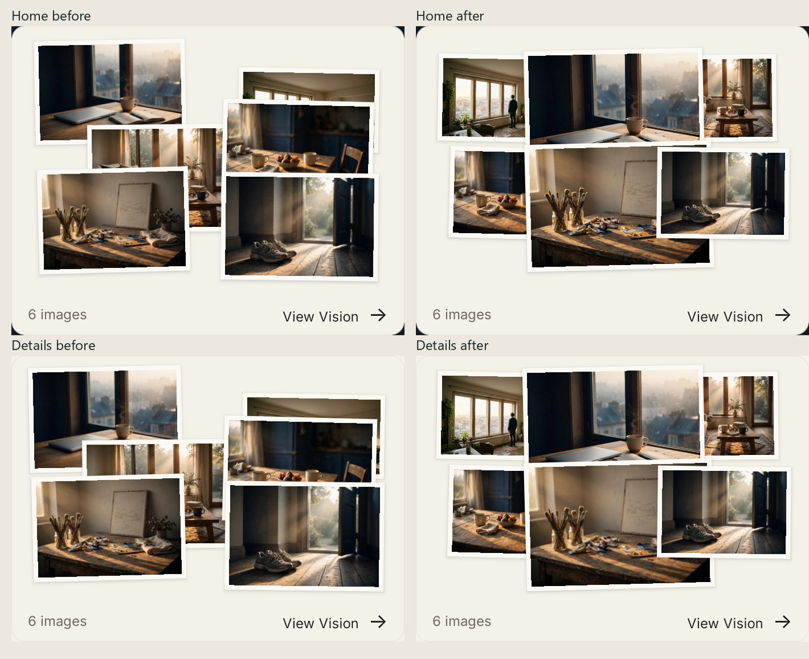

# Anchor 2.0 — Vision Pass 4

Implemented locally on 2026-10-10. Automated checks pass and Android development fixtures were visually inspected. Authenticated native save/reopen/restart and iOS runtime acceptance remain open. No deployment, commit, or database change was made for this pass. The shared checkout already contained substantial mobile and backend work; it was preserved.

## 1. Root causes

**Compact composition:** the previous algorithm chose three rows of two images for six-photo boards, anchored row cells at opposite canvas edges, then aspect-fitted each photo into its cell. Landscape sources lost height and width while the empty cell remained part of the spacing calculation. A middle-row inward offset improved contact locally but retained the two-cluster structure. Enlarging every print aggressively during this pass hid subjects, so those iterations were rejected after Android screenshot inspection.

**Return destination:** the composer awaited persistence and called `goBack`, but the underlying V2Vision screen still retained its local `addScene` mode. The navigation stack returned to the correct route with the wrong local state: the Add entrance, not the board.

**Cache race:** an older GET could finish after a confirmed note mutation and publish its stale Vision to every mounted surface. This could make the new note disappear despite a successful save.

**Physical placement:** the previous placement search minimized photo overlap and broke ties at the first grid location. It favored empty corners, including low corners below the initial viewport. That was geometrically clear but visually detached. The new note also lacked a targeted arrival animation and viewport reveal.

## 2. Exact files modified in this pass

- [anchor/mobile/src/components/v2/vision/visionEditorialLayout.ts](../../../src/components/v2/vision/visionEditorialLayout.ts)
- [anchor/mobile/src/components/v2/vision/VisionEditorialPreview.tsx](../../../src/components/v2/vision/VisionEditorialPreview.tsx)
- [anchor/mobile/src/components/v2/vision/V2SavedVision.tsx](../../../src/components/v2/vision/V2SavedVision.tsx)
- [anchor/mobile/src/components/v2/vision/board/VisionBoard.tsx](../../../src/components/v2/vision/board/VisionBoard.tsx)
- [anchor/mobile/src/components/v2/vision/board/VisionBoardScene.tsx](../../../src/components/v2/vision/board/VisionBoardScene.tsx)
- [anchor/mobile/src/components/v2/vision/board/VisionBoardNoteElement.tsx](../../../src/components/v2/vision/board/VisionBoardNoteElement.tsx)
- [anchor/mobile/src/components/v2/vision/notes/visionNotePlacement.ts](../../../src/components/v2/vision/notes/visionNotePlacement.ts)
- [anchor/mobile/src/hooks/v2/vision/useV2Vision.ts](../../../src/hooks/v2/vision/useV2Vision.ts)
- [anchor/mobile/src/navigation/v2/types.ts](../../../src/navigation/v2/types.ts)
- [anchor/mobile/src/screens/v2/vision/V2VisionNoteComposer.tsx](../../../src/screens/v2/vision/V2VisionNoteComposer.tsx)
- [anchor/mobile/src/screens/v2/vision/V2VisionScreen.tsx](../../../src/screens/v2/vision/V2VisionScreen.tsx)
- [anchor/mobile/src/screens/v2/system/VisionVisualQADevHost.tsx](../../../src/screens/v2/system/VisionVisualQADevHost.tsx)
- [anchor/mobile/src/components/v2/vision/__tests__/visionEditorialLayout.test.ts](../../../src/components/v2/vision/__tests__/visionEditorialLayout.test.ts)
- [anchor/mobile/src/components/v2/vision/notes/__tests__/visionNotePlacement.test.ts](../../../src/components/v2/vision/notes/__tests__/visionNotePlacement.test.ts)
- [anchor/mobile/src/hooks/v2/vision/__tests__/useV2Vision.test.tsx](../../../src/hooks/v2/vision/__tests__/useV2Vision.test.tsx)
- [anchor/mobile/src/screens/v2/vision/__tests__/V2VisionNoteComposer.test.tsx](../../../src/screens/v2/vision/__tests__/V2VisionNoteComposer.test.tsx)
- [anchor/mobile/src/screens/v2/vision/__tests__/V2VisionScreen.addImage.test.tsx](../../../src/screens/v2/vision/__tests__/V2VisionScreen.addImage.test.tsx)

Additional artifacts are confined to this directory: screenshots, comparison image, diagnostic iteration captures, test logs, geometry measurements, a pre-change layout snapshot, the measurement script, this report, and `files-modified.txt`. No Notes material assets or backend schema were changed in this pass.

## 3. Before/after evidence

The before/after uses the same six local photographic sources and the production preview components. Home before was captured in this run during the start of Fast Refresh; the comparison crops the card below the refresh banner. Details before comes from the existing Pass 3 Android artifact, copied here unchanged. The user-referenced attachments were not available in this conversation; this is a comparison against the available checkout evidence.

After inspection: all six photographs remain present, two central prints are larger, the center is occupied by actual photographs rather than cream gaps, and the collage has one connected footprint. Rotation stays below 1.5 degrees and the card dimensions are unchanged. Supporting prints remain smaller to create hierarchy. Their width did **not** increase uniformly: some are smaller than the previous layout. This pass therefore does not claim 20–35% enlargement for every photograph.

Measurements below are deterministic normalized frame widths for six 1.5-aspect photographs on 360×245 Home and 360×223 Details canvases. They describe the packing geometry, not face detection or a universal real-device size guarantee.

| Surface | First dominant print growth | Second dominant print growth | Mean width growth across all six |
|---|---:|---:|---:|
| Home | 22.8% | 22.8% | -1.1% |
| Details | 20.3% | 20.3% | -3.1% |

The layout intentionally prioritizes hierarchy and subject readability over uniform density. Native screenshot inspection is the visual evidence; the geometry measurements alone are not visual acceptance.

## 4. Improved composition algorithm

1. Resolve the measured container width/height and the decoded source aspect ratios, retaining the aspect cache across signed-URL refreshes.
2. Build actual print dimensions in physical coordinates. A connected row uses overlap as a fraction of adjacent print width, not empty grid-cell width.
3. Evaluate deterministic row-count candidates. For 4–8 images, no row has more than three photographs; the six-photo landscape fixture becomes two connected rows of three.
4. Place the first photograph centrally in the first three-print row, with a larger print height. A second central print gives the composition hierarchy without a giant card-height increase.
5. Keep partial final rows at the preceding print height and center them, avoiding an oversized partial row that shrinks the rest of the board.
6. Fit the full rotated bounding footprint inside explicit safe margins. Score candidate print area together with the smallest print area to avoid sacrificing an extreme-aspect source.
7. Use small deterministic rotations and ordered overlapping layers. Source IDs, photograph selection, and canonical returned order stay intact.

The image renderer still fits its aperture after allowing for the existing paper border, so portraits and extreme aspect ratios keep their proportions. Unknown image geometry uses containment until decoding provides dimensions. Home and Details use the same packing language with their existing aspect ratios and margins.

## 5. Note navigation and confirmed persistence

Opening the composer clears the underlying Vision Add mode and pending photo/replacement state. Successful save uses native-stack `popTo('V2Vision', ..., { merge: true })`, returning to the existing board route rather than adding another Vision instance. A confirmed saved note ID targets the reveal. The ordinary Back path remains available for cancellation and the isolated QA host.

The hook commits the returned server Vision into the shared account-scoped read cache before navigation. Mutation versions prevent older in-flight GET responses or stale GET errors from overwriting a confirmed note response. A regression test mounts separate board/composer hooks and proves both retain the new note after an older GET resolves.

No optimistic success is shown. The existing save lock blocks duplicate taps, and the same client request ID survives retry. Save failures keep the draft, material, and editor intact. Editing preserves the existing note transform while changing its selected material/text.

## 6. Physical placement, reveal, animation and compatibility

New placements consider photograph corner/edge candidates plus fallback positions. They penalize central subject regions, especially the hero, protect the Anchor card, avoid active notes, and prefer the visible upper composition. A small inset keeps new notes away from rigid board-edge alignment. This is a central-region heuristic: the app has no dependable face/focal metadata, so it cannot guarantee face avoidance for every real image.

Each material retains its existing renderer, typography, surface asset, paper edge, tint and shadow. This pass adds no generic note card styling. Preset rotation is retained; neutral presets receive a subtle -1.2-degree placement. Existing notes are not migrated or repositioned.

After a confirmed save, the board clears photo/card focus, measures its position in the scrolling viewport, and scrolls to the note if needed. The note settles from 96% to its saved scale with opacity and a 1.2-degree settling offset over 280 ms, delayed briefly for the return transition/reveal. There is no bounce or celebration. Reduced motion applies the final visible state and an immediate scroll.

Notes remain inside the shared board scene and camera transform. Existing drag/pinch/rotation persistence uses normalized x/y, dimensions, scale, rotation and layerOrder, with the existing API-compatible clamp. No database change is needed.

Android fixture selection and dragging were exercised. UI bounds moved from `[25,696][221,892]` to `[168,749][363,944]` in the local fixture. This proves touch movement on the native component; the fixture write callback updates local state and does not prove a backend save.

## 7. Test results and verification matrix

| Check | Result / evidence |
|---|---|
| TypeScript | `tsc --noEmit` exited 0; [final log](types-final.log) |
| Broad Vision / Share / Visualize / Details regressions | 72 suites, 734 tests passed; [log](regressions-final.log) |
| Checks after final composition/board refinements | 7 suites, 92 tests passed; [log](last-verification.log) |
| Persisted note rehydration and saved-board regressions | 3 suites, 21 tests passed; [log](persistence-final.log) |
| Final placement inset / bounds | 6 tests passed; [log](placement-final.log) |
| Save, failures, retries, duplicate taps and all 26 selected styles | Composer tests pass; persistence is mocked in these tests |
| Note create/edit/delete/restore, stale-read protection, persisted transform | Hook tests pass |
| Drag/pinch/rotation and failed transform-write rollback | Board note gesture tests pass |
| Photos-only Visualize and Share Studio contracts | Included in passing broad regression run |
| Scoped whitespace verification | `git diff --check` passed; Git reported line-ending normalization notices only |

The runs overlap; test counts are not additive. The broad regression run preceded the final small refinements; focused subsequent checks cover the affected files.

Actual Android screenshots captured and inspected:

- Home: [1](home-1-final.png), [3](home-3-final.png), [6](home-6-final.png), [8](home-8-final.png).
- Details: [1](details-1-final.png), [3](details-3-final.png), [6](details-6-final.png), [8](details-8-final.png).
- Mixed source ratios: [Home](home-6-mixed-final.png), [Details](details-6-mixed-final.png). These use existing portrait stand-ins and landscape sources; they are fixtures, not a user's saved photographs.
- Note materials: [sticky](note-placement-sticky-final.png), [torn paper](note-placement-paper-final.png), [editorial](note-placement-editorial-final.png).
- [Native note drag](note-drag-after.png), with original/changed bounds in `note-ui.xml` and `note-drag2.xml`.

The automated suite covers failed save/retry, editing, geometry persistence and restoration; it also tests iOS and Android keyboard avoidance. Platform assertions are not iOS device evidence.

## 8. Remaining limitations

- The current Android session's Home did not expose a usable live Vision. Authenticated save → direct board return → native animation, reopening a real saved Vision, and application restart against the backend are **not verified** in this run. A test Anchor was requested for that remaining validation.
- iOS hardware/simulator runtime, physical-device frame pacing and full native pinch/rotation were unavailable or not exercised.
- The target 20–35% width enlargement is achieved for the dominant prints, not every photograph. Supporting photographs are intentionally smaller. Uniform enlargement of all six remains outside the verified result.
- Subject avoidance is heuristic. A photo with its subject at an unusual edge can still be covered by a neighboring print or note.
- Geometry can recompose after initially unknown source dimensions decode. Cached ratios stabilize subsequent rendering, but cold-entry stability across arbitrary remote images remains a device acceptance item.
- The note renderer retains existing long-text scrolling and material typography; all 26 persistence choices are tested, while native material screenshot review sampled the three material families.

## 9. Regression risks

The changes are concentrated in shared preview geometry, note navigation/cache updates, and the board reveal path. Risk areas are unusual image-aspect mixes, navigation initiated without an existing Vision route, legacy note placement near viewport boundaries, cold decoding, and measured scrolling under large text/insets. Existing server/API fields and material renderers remain compatible. Generation, premium gating, photo editing, Share Studio, Anchor art and photos-only Visualize passed the relevant automated checks; their complete authenticated native journeys were not rerun.

## 10. Evidence-based quality assessment

Self-assessed, not an independent reviewer score:

| Dimension | Score | Evidence / qualification |
|---|---:|---|
| Six-photo composition | 8.5/10 | Connected central hierarchy, six recognizable photographs, unchanged card dimensions; supporting prints did not all grow |
| Navigation/cache correctness | 9/10 automated | Confirmed-save pop, Add-state correction, duplicate suppression and stale-read regression tests; native authenticated route pending |
| Physical note integration | 8.5/10 | Upper photograph-edge placement, distinct materials, native selection/drag, shared transforms; no semantic face detection |
| Acceptance coverage | 7/10 | Strong automated and Android fixture evidence; live save/restart and iOS remain open |

**Overall: 8.3/10 for the verified result.** This is a local implementation with clear outstanding acceptance items, not a claim that every requested native acceptance check is complete.
